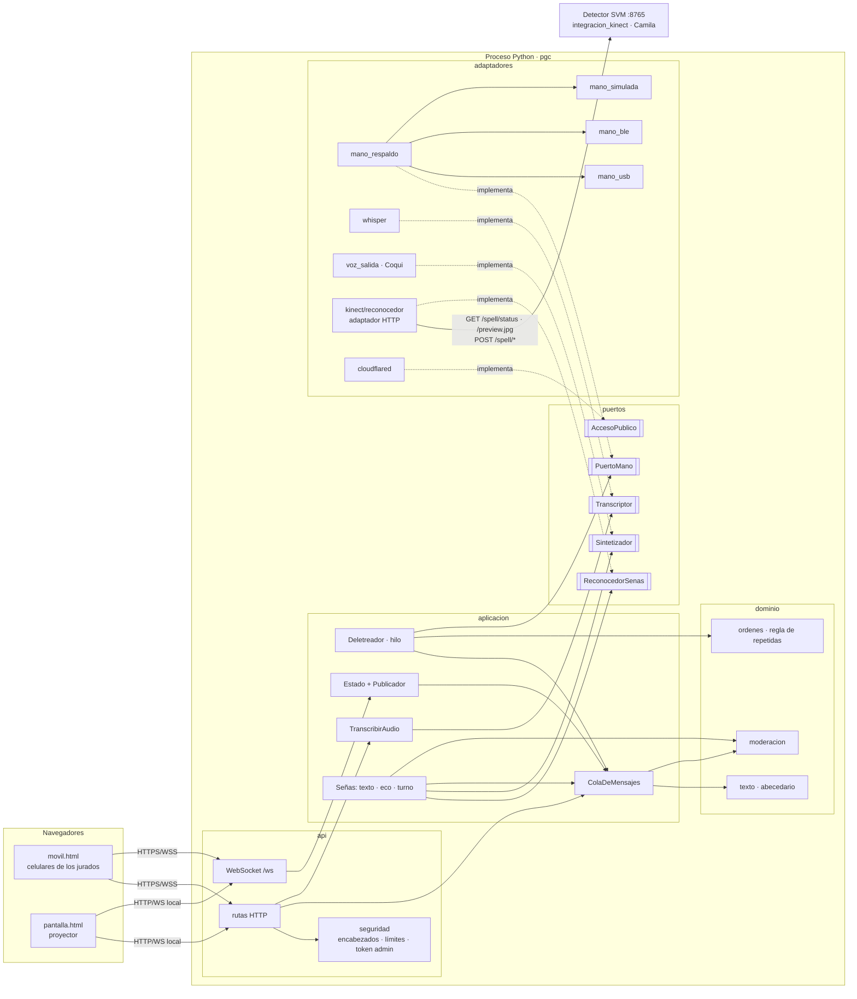
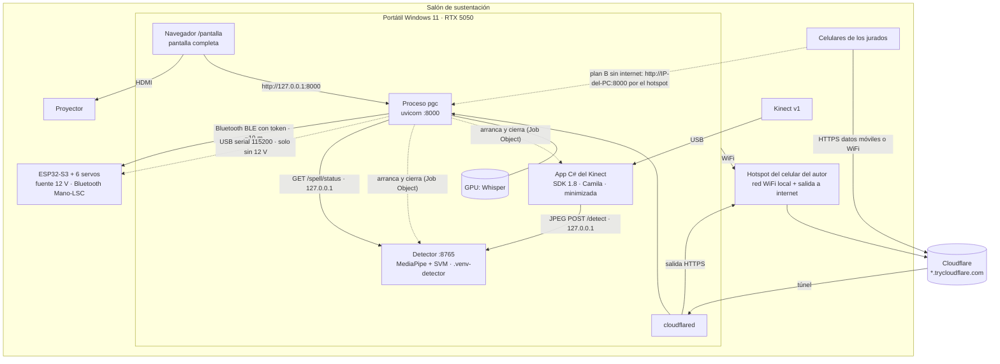
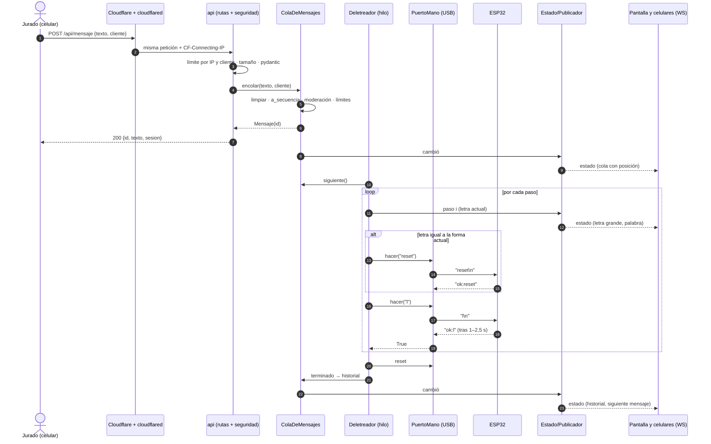

# Arquitectura del sistema — Mano robótica bidireccional en LSC

Proyecto de Gestión del Conocimiento (PGC) · Ingeniería de Sistemas y Computación · Universidad de Cundinamarca, extensión Facatativá.
Estado: **propuesta aprobada** el 20/10/2026, con los ajustes de §D. La migración avanza por etapas (§C).

Este documento propone cómo reorganizar el código actual (fase 1: servidor, páginas y mano por USB) para que:
- sea fácil de entender y de evaluar;
- mis compañeros puedan conectar el Kinect y el reconocimiento de señas **sin tocar mi código**;
- sea seguro aunque la página se publique en internet por el túnel.

Todo esto **sin cambiar el comportamiento**, que ya está fijado por pruebas (§0).

---

## 0. Punto de partida y red de seguridad

### Código actual

| Archivo | Qué hace | Problema para crecer |
|---|---|---|
| `servidor.py` (411 líneas) | Configuración (argparse), estado, cola, hilo de la mano, regla de letras repetidas, rutas, WebSocket y arranque | Mezcla todo: reglas, hilos, HTTP y hardware en un archivo |
| `texto_util.py` | Texto → secuencia de letras | Bien aislado; las letras están fijas en el código |
| `mano_serial.py` | Protocolo serial y modo simulado en una sola clase | El modo simulado no se puede usar sin la clase USB; no hay forma de agregar WiFi |
| `tunel.py`, `voz_entrada.py` | cloudflared y Whisper | Bien aislados, pero el servidor los crea directamente |
| `esp32/main.py` | Firmware | Acepta cualquier comando (incluido `salir`, que lo detiene) |

### Pruebas de caracterización (paso 0, ya hechas)

`py -3.11 -m pytest` → **109 pruebas, todas pasan** (≈ 10 s, sin hardware, sin Whisper, sin internet). Las corrí cuatro veces seguidas para descartar pruebas inestables por los hilos.

| Archivo | Qué fija |
|---|---|
| `tests/test_texto.py` | `limpiar` y `a_secuencia`: tildes, ü, ñ (aproximada con n, o no disponible si la mano no tiene n), números a palabras, recorte a 60 (incluido el espacio que puede quedar al final), espacios y puntuación, letras que reporta la mano |
| `tests/test_cola.py` | Límite de 2 por cliente (contando el que está en curso), cola global de 30, rechazos ("gh", "¡¿?!"), cancelar solo lo propio, que la instantánea no exponga el id del cliente, **órdenes exactas a la mano** ("calle" → `c a l reset l e reset`, "carro", "ll ll", "ñn", "lgl", "hola", "ve mi"), qué pasa si la mano no confirma, saltar mensaje, orden de llegada, historial de 6, reconexión |
| `tests/test_api.py` | Todas las rutas con `TestClient`: páginas, `no-store`, logo, QR (decodificado: apunta a la URL pública), `/docs` cerrado, sin CORS, estado con y sin túnel, previa, mensajes y sus mensajes de error exactos, 422 de pydantic, transcripción (límite de 10 MB exacto, 503, 500, recorte a 60, **archivo temporal siempre borrado**), rutas de administración (403 desde un celular y por el túnel; 200/404 desde el PC), y el WebSocket (estado inicial, seguimiento de un mensaje y varios clientes a la vez) |
| `tests/test_mano_serial.py` | Protocolo con un puerto serial falso: autodetección por VID, DTR/RTS en False al abrir, `ping`/`letras`, reinicio suave con Ctrl-C Ctrl-D, `ok:`/`na:`, líneas ajenas, `error:` en el log, timeout, pérdida de la conexión |
| `tests/test_otros.py` | URL del túnel, túnel sin cloudflared, Whisper sin cargar, y que las páginas no carguen nada de internet y conserven sus controles y las rutas que usan |

**Regla de diseño de las pruebas:** todos los imports y puntos de reemplazo están solo en `tests/conftest.py`. Al mover módulos se cambia ese archivo, y **las 109 pruebas deben seguir pasando sin editarlas**. Si una prueba tiene que cambiar, es porque cambió el comportamiento, y eso solo se permite en las etapas de seguridad, con tu aprobación (§C).

---

## A. Arquitectura

### A.1 Estilo: hexagonal (puertos y adaptadores), en versión pragmática

**Por qué encaja en este proyecto:**
1. **El sistema es un núcleo con muchas piezas externas que cambian**: mano por USB o por WiFi (o simulada), Whisper, TTS, Kinect, túnel, navegador. La lógica valiosa (convertir texto en órdenes, la regla de letras repetidas, la cola justa, el modo eco) no debe depender de ninguna de ellas.
2. **Trabajo en equipo con un contrato claro**: mis compañeros implementan un puerto (`ReconocedorSenas`) y yo programo contra esa interfaz. Ninguno edita el código del otro.
3. **Se prueba sin hardware**: lo que ya hacen las 109 pruebas con una mano falsa queda como diseño, ya no como un truco de `monkeypatch`.
4. **Es defendible ante los jurados**: cada dependencia apunta hacia adentro (adaptadores → aplicación → dominio), y eso se puede mostrar en un diagrama.

**Qué NO hago para no caer en sobreingeniería:**
- Sin contenedor de inyección de dependencias ni frameworks: el armado se hace a mano en un solo archivo (`pgc/arranque.py`).
- Sin base de datos, colas externas ni microservicios: es un solo proceso en un portátil (ver ADR-3).
- Sin capas "repositorio" ni DTO duplicados: los esquemas pydantic viven solo en la API.
- Los puertos son `typing.Protocol` de pocas líneas, sin clases base abstractas pesadas.
- Se mantienen los **hilos**, que ya funcionan, en vez de reescribir a asyncio: el puerto serial bloquea, y la mano hace una cosa a la vez.

### A.2 Estructura de carpetas propuesta

```
ProyectoPGC/
├─ pgc/
│  ├─ __main__.py            # py -3.11 -m pgc  (mismas opciones que hoy: --simular, --puerto, ...)
│  ├─ arranque.py            # raíz de composición: lee config, crea adaptadores, arma la app
│  ├─ config.py              # Configuración tipada: valores por defecto ← .env ← variables ← opciones CLI
│  ├─ dominio/               # Puro: sin hilos, sin E/S, sin FastAPI
│  │  ├─ texto.py            # limpiar(), a_secuencia()   (hoy texto_util.py)
│  │  ├─ abecedario.py       # Abecedario: letras disponibles y aproximaciones, cargado de letras.json
│  │  ├─ mensaje.py          # Mensaje, Paso, ResultadoPaso (dataclasses)
│  │  ├─ ordenes.py          # planificar_ordenes(): regla de letras repetidas, espacio = reset
│  │  └─ moderacion.py       # Filtro de palabras ofensivas (lista en datos)
│  ├─ aplicacion/            # Casos de uso; usan puertos, nunca adaptadores concretos
│  │  ├─ cola.py             # ColaDeMensajes: límites, cancelar, saltar (thread-safe)
│  │  ├─ deletreo.py         # Deletreador: hilo que saca mensajes y habla con PuertoMano
│  │  ├─ estado.py           # Instantánea del sistema + Publicador (avisa a los WebSocket)
│  │  ├─ voz.py              # TranscribirAudio: validar, transcribir, recortar a 60
│  │  ├─ senas.py            # Kinect → texto (eventos del contrato), controles y estado para las pantallas
│  │  └─ turno.py            # Turno del Kinect: un jurado a la vez, liberación por inactividad
│  ├─ puertos/               # Interfaces (typing.Protocol)
│  │  ├─ mano.py             # PuertoMano
│  │  ├─ transcriptor.py     # Transcriptor (voz → texto)
│  │  ├─ sintetizador.py     # Sintetizador (texto → voz)
│  │  ├─ reconocedor.py      # ReconocedorSenas  ← contrato para mis compañeros (§A.4)
│  │  └─ tunel.py            # AccesoPublico (URL pública o None)
│  ├─ adaptadores/
│  │  ├─ mano_usb.py         # Protocolo serial (hoy mano_serial.py)
│  │  ├─ mano_simulada.py    # Simulación (hoy mezclada dentro de Mano)
│  │  ├─ mano_respaldo.py    # Cadena Bluetooth → USB → simulada, con autodetección
│  │  ├─ mano_ble.py         # Bluetooth BLE (UART de Nordic, con token); reemplazó a mano_wifi.py (ADR-8)
│  │  ├─ whisper.py          # faster-whisper (hoy voz_entrada.py)
│  │  ├─ voz_salida.py       # Coqui VITS en español (Sintetizador): dice las frases del Kinect
│  │  ├─ cloudflared.py      # Túnel (hoy tunel.py)
│  │  ├─ red.py              # ip_local()
│  │  └─ kinect/             # ReconocedorSenas real (ADR-9)
│  │     ├─ reconocedor.py   # ReconocedorKinect: adaptador HTTP del detector de integracion_kinect/
│  │     ├─ procesos.py      # LanzadorKinect: arranca el detector y el capturador, atados al proceso
│  │     └─ camara_pc.py     # Cámara del PC → detector (para probar sin Kinect)
│  └─ api/
│     ├─ app.py              # crear_app(servicios): FastAPI, ciclo de vida, middlewares
│     ├─ esquemas.py         # Modelos pydantic de entrada y salida
│     ├─ dependencias.py     # Acceso a servicios, verificación de administrador, IP real
│     ├─ seguridad.py        # Encabezados, límite de peticiones, tamaño de cuerpo, Origin
│     └─ rutas/              # paginas.py, mensajes.py, voz.py, admin.py, ws.py
├─ datos/
│  ├─ letras.json            # Letras de la mano, aproximaciones, notas para la pantalla
│  └─ palabras_bloqueadas.txt
├─ web/                      # movil.html, pantalla.html, logo-udec.png (sin cambios de diseño)
├─ firmware/esp32/           # main.py, letras.json (posiciones), protocolo.md
├─ integracion_kinect/       # Parte de Camila, se usa tal cual: detector/ (MediaPipe + SVM, server_web_svm.py)
│                            #   y capturador/ (app C# del Kinect, SDK 1.8)
├─ tests/                    # unidad (dominio), aplicación, api, contratos de puertos
├─ scripts/                  # prueba_e2e.py, capturas.py, auditar_dependencias.bat
├─ docs/                     # ARQUITECTURA.md, ADR, diagramas
├─ servidor.py               # Se conserva como atajo: llama a pgc.__main__.main()
├─ iniciar.bat, requirements.txt, requirements-dev.txt, .env.example, pytest.ini
```

**Regla de dependencias** (se puede comprobar con una prueba que revise los imports):
`dominio` no importa nada del proyecto. `aplicacion` importa `dominio` y `puertos`. `adaptadores` importa `puertos` y `dominio`. `api` importa `aplicacion`. Solo `arranque.py` conoce los adaptadores concretos.

**Compatibilidad durante la migración:** `servidor.py`, `texto_util.py` y `mano_serial.py` se quedan como atajos de una línea que importan de `pgc/`. Así `iniciar.bat`, los comandos de ESTADO_FASE1.md y la costumbre de `py -3.11 servidor.py --simular` siguen funcionando. Se pueden borrar al final, si quieres.

### A.3 Puertos principales

```python
class PuertoMano(Protocol):
    modo: str                  # "real" | "simulada"   (lo que hoy ve la pantalla)
    puerto: str | None         # "COM5", "192.168.43.20" o None
    letras: set[str] | None    # lo que reporta la mano; None = usar el abecedario por defecto
    @property
    def conectada(self) -> bool: ...
    def conectar(self) -> bool: ...
    def cerrar(self) -> None: ...
    def hacer(self, orden: str) -> bool:   # letra o "reset"; bloquea hasta la confirmación
        ...

class Transcriptor(Protocol):
    estado: str                # "sin cargar" | "cargando" | "listo" | "error" | "desactivado"
    dispositivo: str | None
    def cargar_en_segundo_plano(self) -> None: ...
    def transcribir(self, ruta_audio: str) -> str: ...

class Sintetizador(Protocol):   # fase 4
    estado: str
    def cargar_en_segundo_plano(self) -> None: ...
    def decir(self, texto: str) -> None:   # bloquea hasta terminar de hablar
        ...

class AccesoPublico(Protocol):
    estado: str                # "apagado" | "iniciando" | "activo" | "error" | "no instalado"
    url: str | None
    def iniciar(self) -> None: ...
    def detener(self) -> None: ...
```

Los nombres de estado y los valores (`"real"`, `"simulada"`, `"listo"`…) se conservan porque las páginas y las pruebas dependen de ellos.

### A.4 Contrato del puerto `ReconocedorSenas` (para mis compañeros)

La versión para enviar a mis compañeros, corta y autocontenida, está en [`CONTRATO_KINECT.md`](CONTRATO_KINECT.md).

**Objetivo:** que mis compañeros entreguen una clase en `pgc/adaptadores/kinect/`, cambien una línea del `.env` y el sistema la use, sin editar nada fuera de su carpeta.

```python
# pgc/puertos/reconocedor.py
from dataclasses import dataclass
from typing import Callable, Literal, Protocol

@dataclass(frozen=True)
class EventoSena:
    tipo: Literal["letra", "espacio", "borrar", "fin"]
    letra: str | None = None      # "a".."z" o "ñ", en minúscula; solo si tipo == "letra"
    confianza: float = 1.0        # 0.0 – 1.0
    modelo: str = ""              # "A-mlp", "B-gru", "C-cnn"... (para el informe)
    instante: float = 0.0         # time.monotonic() del cuadro que la confirmó
    latencia_ms: float = 0.0      # desde la captura hasta la decisión (para el informe)

EstadoReconocedor = Literal["apagado", "cargando", "listo", "sin_persona", "error"]

class ReconocedorSenas(Protocol):
    estado: EstadoReconocedor
    detalle: str                  # texto corto para la pantalla: "Kinect v1 · modelo A", motivo del error...

    def iniciar(self, al_evento: Callable[[EventoSena], None],
                al_cambiar_estado: Callable[[], None]) -> None:
        """Carga modelos y abre el Kinect EN SEGUNDO PLANO; retorna enseguida."""

    def detener(self) -> None:
        """Libera el Kinect y los hilos. Debe poder llamarse más de una vez."""
```

**Reglas del contrato:**
1. **Ellos deciden cuándo una letra está "confirmada"**: la estabilización (N cuadros iguales, umbral de confianza) y el corrector por caracteres son parte de su modelo. Solo emiten eventos ya decididos: `letra`, `espacio` (pausa o gesto de separación), `borrar` y `fin` (la persona terminó la palabra o la frase).
2. **Los callbacks se pueden llamar desde cualquier hilo**, pero deben retornar enseguida. Mi lado copia el evento a una cola interna y nunca bloquea al reconocedor.
3. **Lo que hace mi lado con los eventos**: arma el texto, lo filtra (moderación), lo muestra por WebSocket en la pantalla y en el celular, lo dice en voz alta con el `Sintetizador` y, en modo eco, lo encola a la mano. Además controla el turno de un solo usuario y lo libera por inactividad.
4. **Errores**: el reconocedor nunca lanza excepciones hacia fuera desde sus hilos. Pasa a `estado="error"`, con el motivo en `detalle`, y llama a `al_cambiar_estado()`.
5. **Cómo se conecta**: en el `.env`, `PGC_RECONOCEDOR=pgc.adaptadores.kinect.reconocedor:ReconocedorKinect`. `arranque.py` importa esa ruta, construye la clase sin argumentos (o con su propia sección `PGC_KINECT_*` del `.env`) y llama a `iniciar`. Si la ruta no existe o falla, se usa el **reconocedor simulado** y la pantalla muestra "Kinect: no disponible".
6. **Pruebas de contrato**: `tests/contratos/test_reconocedor.py` comprueba con cualquier implementación que inicia sin bloquear, que los eventos cumplen el formato y que `detener()` se puede llamar dos veces. Mis compañeros corren `py -3.11 -m pytest tests/contratos --reconocedor=<ruta>` antes de entregar.
7. **Doble para mi lado**: `ReconocedorSimulado(texto="hola")` emite los eventos de ese texto con pausas. Me sirve para construir y probar el modo eco y la pantalla antes de que llegue su parte.

#### A.4.1 Implementación real: `ReconocedorKinect` (26/10/2026, ADR-9)

La parte de Camila llegó como **dos programas** en `integracion_kinect/`:
- la app C# (`capturador/`), que envía cada imagen del Kinect en JPEG a `POST /detect`;
- el detector (`detector/server_web_svm.py`, en `127.0.0.1:8765`), que con MediaPipe Hands + **un SVM (kernel RBF) sobre 89 características de los 21 puntos** confirma letras (misma predicción ≥ 0,7 s y ≥ 4 imágenes; retirar la mano 0,5 s entre letras) y las escribe en su propio texto.

Se usan **tal cual**. `pgc/adaptadores/kinect/reconocedor.py` los conecta al contrato:
- consulta `GET /spell/status` cada 0,3 s (`Texto: …\nEstado: …`) y convierte el cambio del texto en eventos: letra nueva → `letra` (minúscula), espacio → `espacio`, texto más corto → `borrar` (se borra hasta el prefijo común y se escribe el resto);
- `fin` lo emite el adaptador cuando alguien toca **Terminar**: primero recoge las letras pendientes, luego emite `fin` y deja en blanco el texto del detector (`POST /spell/clear`);
- `GET /preview.jpg` (cada 1 s, o 5/s mientras el proyector la muestra) dice si llegan imágenes y guarda la última para el proyector;
- estado: sin detector o sin imágenes → `error` con detalle **"Kinect no conectado"**; reconociendo con la mano a la vista → `listo`; detenido o sin mano → `sin_persona`;
- si el detector pasa a devolver JSON (`texto`, `estado`, `activo`, `confianza`, `latencia_ms`), se usa sin cambiar el adaptador.

**Extensiones opcionales del contrato (§3.1 de CONTRATO_KINECT.md, versión 1.1):** `controlar(accion)` (`iniciar`, `detener`, `espacio`, `borrar`, `terminar`), `imagen()`, los atributos `conectado`, `camara` y `activo`, y `desde_config(cfg)` para recibir `PGC_KINECT_*`. Un reconocedor sin ellas sigue funcionando (sin botones).

Es **el único** que habla con el detector: los celulares y el proyector reciben todo por el WebSocket (§B.4 M6).

### A.5 Diagramas

**Componentes y dependencias** (las flechas apuntan a lo que se usa):



**Despliegue el día de la sustentación:**



**Secuencia de un mensaje de punta a punta:**



### A.6 Configuración centralizada (`pgc/config.py`)

Una sola dataclass congelada (`Config`) con **todos** los valores que hoy están repartidos como constantes. El orden de prioridad es: valor por defecto → `.env` → variables de entorno → opciones de la línea de comandos (las de hoy siguen igual). Uso `python-dotenv`, que ya está instalado; no hace falta `pydantic-settings`.

| Variable | Por defecto (= hoy) | Hoy está en |
|---|---|---|
| `PGC_PUERTO_WEB` | 8000 | argparse |
| `PGC_MANO` | `auto` (Bluetooth → USB → simulada); también `ble`, `usb`, `simulada` | `--simular`, `--puerto` |
| `PGC_MANO_PUERTO` | vacío (autodetección) | `--puerto` |
| `PGC_MANO_VIDS` | `303A,1A86,10C4` | mano_serial.py |
| `PGC_MANO_TIMEOUT_LETRA` | 12.0 | mano_serial.py |
| `PGC_MANO_BLE_NOMBRE` / `PGC_MANO_BLE_TOKEN` | `Mano-LSC` / vacío | (nuevo; el token es secreto) |
| `PGC_PAUSA_LETRA` / `PGC_PAUSA_NO_DISPONIBLE` | 0.5 / 0.9 | servidor.py |
| `PGC_MAX_CARACTERES` | 60 | texto_util.py |
| `PGC_MAX_PENDIENTES_CLIENTE` / `PGC_MAX_COLA` | 2 / 30 | servidor.py |
| `PGC_AUDIO_MAX_MB` / `PGC_AUDIO_MAX_SEGUNDOS` | 10 / 15 (nuevo límite) | servidor.py |
| `PGC_TUNEL` | `cloudflared` (o `no`) | `--sin-tunel` |
| `PGC_VOZ_MODELO` | `medium` | voz_entrada.py |
| `PGC_RECONOCEDOR` | `simulado` | (nuevo) |
| `PGC_LOG_TEXTOS` | `false` (nuevo; ver §B) | — |

`.env.example` documenta cada variable. `.env` nunca se copia ni se entrega. Se cargan con rutas relativas a la carpeta del proyecto, nunca absolutas.

### A.7 Decisiones de arquitectura (ADR)

**ADR-1 · Mano por USB, con WiFi como respaldo opcional**
- *Contexto:* USB es lo más estable en una sala con WiFi incierto (decisión ya tomada en CLAUDE.md). Pero un cable que se suelta en plena demo deja la mano muerta.
- *Decisión:* `mano_respaldo` intenta en orden **USB → WiFi (si está configurado) → simulada**. Cada 3 s busca de nuevo la opción mejor cuando está en reposo (como la autodetección de hoy). Nunca cambia de medio en mitad de un mensaje. La pantalla muestra siempre el medio activo.
- *Consecuencias:* el WiFi exige un firmware con servidor TCP, un solo cliente y un token (§B). Hasta que se implemente, la cadena es USB → simulada, idéntica a hoy.
- *Actualización:* el medio inalámbrico pasó a ser Bluetooth y quedó primero en la cadena (ADR-8).

**ADR-2 · Túnel de Cloudflare con modo sin internet**
- *Contexto:* el micrófono del celular solo funciona con HTTPS, y el quick tunnel da HTTPS gratis. Pero depende de internet y la URL cambia en cada arranque.
- *Decisión:*
  - Con internet: túnel y QR con la URL `https://…trycloudflare.com`.
  - Sin internet: el QR apunta a `http://IP-del-PC:8000` por el hotspot. Ahí el micrófono no funciona y la página ofrece el plan B, que ya existe: subir una nota de voz grabada con la app del celular.
  - La pantalla indica en qué modo está.
  - *Descartado:* HTTPS local con certificado propio, porque cada celular mostraría una advertencia que un jurado no sabría aceptar.
- *Consecuencias:* el código no depende de que haya internet. Lo que se pierde sin internet es solo la grabación directa.

**ADR-3 · Cola en memoria, sin base de datos**
- *Contexto:* un solo proceso, una sola mano, mensajes que viven segundos o minutos, y una demo de una hora. Reiniciar el servidor ya descarta la cola y avisa a los celulares (marca de sesión).
- *Decisión:* cola, historial y límites en memoria, protegidos por un `threading.Condition`.
- *Cuándo haría falta una base de datos (SQLite primero):*
  - si hay que conservar mensajes al reiniciar;
  - si se quiere un registro para el informe (sin datos personales);
  - si varios procesos o PC atienden la misma mano;
  - si se guarda el dataset LSC con sus metadatos. Eso sí lo necesitarán mis compañeros, pero va en su módulo, no en la cola.
- *Consecuencias:* la `ColaDeMensajes` queda detrás de una interfaz pequeña, así que cambiarla a SQLite no tocaría la API.

**ADR-4 · Las letras de la mano son datos, no código**
- *Contexto:* hoy las 21 letras están repetidas en tres lugares: `LETRAS_POR_DEFECTO` en Python, el diccionario `acciones` del firmware y las funciones `a()…y()`. Vas a agregar G, H y S.
- *Decisión:*
  - **En el PC**: `datos/letras.json` con las letras por defecto, las aproximaciones (ñ→n), las letras con movimiento (j, z, ñ) y el texto de cada nota para la pantalla. Lo que manda sigue siendo lo que la mano responde a `letras`; el archivo es solo el valor por defecto.
  - **En el firmware**: `letras.json` con la **lista ordenada** de movimientos de cada letra (dedo y posición: `abierto`, `cerrado`, `mitad`, `cuarto`, `cuarto_mas`), que es exactamente lo que hacen hoy las funciones. Agregar una letra pasa a ser editar un archivo.
- *Consecuencias:* el cambio del firmware se verifica sin hardware. Un arnés en el PC ejecuta el firmware viejo y el nuevo con un `machine.PWM` falso y compara, letra por letra, la secuencia de `duty_ns` y pausas: deben ser idénticas. Solo después se carga en el ESP32.

**ADR-5 · Hilos para el hardware, asyncio solo en la web**
- *Decisión:* la mano, Whisper, el TTS y el Kinect corren en hilos. FastAPI/uvicorn sigue en asyncio. El puente entre los dos es el `Publicador`, que usa `call_soon_threadsafe`, como hoy.
- *Por qué:* pyserial y los modelos bloquean, y reescribirlos en asyncio no aporta nada en un solo PC.

**ADR-6 · Configuración por archivo `.env` y armado en un solo lugar**
- *Decisión:* los adaptadores se eligen en `arranque.py` según `Config`. Ningún módulo lee variables de entorno por su cuenta. Así las pruebas arman el sistema con dobles sin `monkeypatch`.

**ADR-7 · Sin inicio de sesión (ni Google ni cuentas) y sin expulsión por inactividad**
- *Contexto:* hace falta saber quién envía cada mensaje y poder frenar a alguien que abuse. La opción obvia sería iniciar sesión con Google.
- *Decisión:* identificar al participante solo con un **nombre opcional** (máx. 20 caracteres, filtrado), más el id aleatorio del celular que ya existe. El presentador puede **bloquear** a un participante durante la sesión desde la pantalla del PC. No hay inicio de sesión ni expulsión por inactividad.
- *Por qué no iniciar sesión con Google:*
  1. **La URL del túnel cambia en cada arranque** (`*.trycloudflare.com`), y OAuth exige registrar de antemano las URL de retorno exactas. Habría que comprar un dominio y un túnel con nombre, y todo dependería de internet y de Google el día de la demo (contradice ADR-2).
  2. **Fricción**: un jurado tendría que escanear el QR, elegir una cuenta, aceptar permisos y volver. Eso cuesta 30–60 s y algunos jurados no querrían hacerlo. Hoy participa con un toque.
  3. **Ley 1581 de 2012** (protección de datos personales, Colombia) y su Decreto 1377 de 2013: recibir el correo y el nombre de Google es tratar datos personales. Exige autorización previa e informada, una finalidad declarada y una política de tratamiento, y da a los titulares derecho a consultar y suprimir sus datos. El nombre opcional, en cambio, lo escribe la persona sabiendo que se verá en el proyector, solo vive en memoria durante la sesión y desaparece al cerrar el servidor. Así se aplica la minimización de datos.
- *Por qué no expulsar por inactividad:* un jurado puede mirar la mano un minuto sin tocar el celular y no debe perder su lugar. La cola ya limita a 2 mensajes por persona, y el bloqueo manual cubre los abusos. Lo único que se libera por inactividad es el turno del Kinect, porque ahí sí hay un solo usuario a la vez.
- *Consecuencias:* la identidad es débil a propósito: quien borre los datos del navegador obtiene un id nuevo. Lo compensan el límite por IP (M5) y el bloqueo manual, suficiente para una sala de sustentación.

**ADR-8 · Mano por Bluetooth (BLE) en lugar de WiFi (22/10/2026)**
- *Contexto:*
  - En la PCB no se pueden conectar USB y 12 V a la vez, así que con la mano encendida el medio tiene que ser inalámbrico.
  - El WiFi obligaba a que el PC y la mano estuvieran en la misma red (el hotspot) y a conocer la IP de la mano. En la prueba, el PC estaba en otra red y no la encontró.
- *Decisión:*
  - Mano **solo por Bluetooth**, sin WiFi en la placa.
  - El ESP32-S3 solo tiene **BLE**: no hay Bluetooth clásico ni puerto COM. Se usa el **servicio UART de Nordic** (RX `6E400002…` para las órdenes y TX `6E400003…` para las respuestas, por notificaciones, en paquetes de 20 bytes).
  - La placa se anuncia como `Mano-LSC` y no hace falta emparejarla.
  - Se mantienen el token (`auth <token>` en 3 s), un solo PC a la vez (conectado, la placa deja de anunciarse) y las mismas órdenes y respuestas del código original.
  - En el PC, `mano_ble.py` usa **bleak** en su propio hilo con asyncio (ADR-5: hacia el resto del sistema es bloqueante).
  - **bleak corre en un proceso aparte** (`ble_puente.py`). Motivo: el Bluetooth de Windows (WinRT) y faster-whisper (ctranslate2) no conviven en el mismo proceso. Con solo importar WinRT antes de cargar Whisper en la GPU, Python se cae con *access violation* (probado el 22/10/2026).
    - `BleakRemoto` tiene la misma forma que bleak, así que `ManoBLE` no cambia.
    - El hijo recibe pedidos en JSON por stdin y responde y avisa por stdout.
    - Se cierra con el servidor: stdin cerrado y Job Object.
    - Si muere, el siguiente intento de conexión lo vuelve a arrancar.
    - Una prueba comprueba que el proceso del servidor nunca carga `bleak` ni `winrt`.
- *Consecuencias:*
  - No depende de ninguna red: el hotspot solo hace falta para el túnel de los celulares.
  - El alcance es de unos 10 m, así que el PC debe quedar cerca de la mano.
  - El Bluetooth de Windows tiene que estar encendido; si está apagado, el log lo dice.
  - Las pruebas usan una radio BLE falsa que ejecuta el `main.py` real y un bleak falso que habla con ella.

**ADR-9 · El Kinect de Camila integrado como proceso aparte, con un adaptador (26/10/2026)**
- *Contexto:* el PR #2 trajo el detector (MediaPipe + SVM) como servidor HTTP en `127.0.0.1:8765`, la app C# que le envía las imágenes, y un lanzador propio (`iniciar_pgc_integrado.py`) que reemplazaba la página del celular desde fuera, consultaba el detector desde **cada celular** (imagen cada 0,2–0,4 s, estado cada 0,7–1 s) y agregaba un segundo sistema de permisos (código de 8 dígitos).
- *Decisión:*
  1. **El detector y la app C# se usan tal cual, en procesos aparte.** Sus versiones (mediapipe 0.10.21, numpy 1.26.4, protobuf 4, scikit-learn 1.5.2 con la que se guardó el modelo) no caben en el Python de la plataforma (numpy 2.4, mediapipe 0.10.9, protobuf 3): van en `.venv-detector`. `LanzadorKinect` los arranca con la plataforma y un Job Object los cierra con ella (como cloudflared), aunque se cierre a la fuerza.
  2. **Un adaptador del contrato** (`ReconocedorKinect`, §A.4.1) es el único que habla con el detector. La pestaña Kinect pasa a ser código normal de `movil.html`, y todo llega por el WebSocket: el número de celulares no cambia la carga del detector (probado con 30).
  3. **Turno de un jurado a la vez en lugar del código de 8 dígitos.** El código daba control por 2 horas a hasta 32 celulares a la vez (no "uno a la vez"), era un segundo mecanismo de permisos junto al token del presentador, obligaba a dictar el código en voz alta y no se enteraba de los bloqueos. El turno usa la identidad que ya existe (participante con nombre y `pid`): se toma con un botón si está libre, se suelta, se libera solo tras 120 s sin usarlo (`PGC_KINECT_TURNO_SEGUNDOS`), el presentador lo libera y bloquear a alguien también le quita el turno. El presentador (PC con token) controla siempre.
  4. **La imagen de la cámara solo en el PC del proyector** (`GET /api/kinect/imagen` exige token y origen local): por el túnel o la red local muestra la cara de quien está señando (Ley 1581, ADR-7).
  5. **"Terminar"** emite `fin`: la frase se dice con Coqui VITS por los parlantes del PC (no con la voz del navegador de cada celular) y, si el **modo eco** está activo, va a la cola de la mano como un mensaje de "Kinect" (las letras que la mano no hace se muestran como no disponibles).
- *Consecuencias:*
  - `iniciar_pgc_integrado.py` y `acceso_kinect.py` quedan **obsoletos** pero no se borran ni se modifican. `movil.html` conserva las marcas que busca ese lanzador, así que sigue funcionando (una prueba lo comprueba).
  - El estado de "Kinect no conectado" cubre tres casos: falta el entorno del detector, el detector no responde o no llegan imágenes (app C# cerrada o Kinect desconectado).
  - El detector no expone confianza ni latencia; los eventos llevan `confianza=1.0` hasta que su `/spell/status` las incluya (pedido en CONTRATO_KINECT.md §8).

---

## B. Seguridad

### B.1 Superficie expuesta

- **Por el túnel**, cualquier persona con la URL llega a `/`, `/pantalla`, `/api/*` y `/ws`. La URL es aleatoria, pero no es un secreto: está en el QR del proyector.
- **Por el hotspot**, cualquiera conectado a esa red llega a `http://IP:8000`.
- **El navegador del propio PC** también es un origen: una página web cualquiera abierta en ese PC puede enviar peticiones a `127.0.0.1:8000`.

### B.2 Hallazgos sobre el código actual

| # | Hallazgo | Riesgo |
|---|---|---|
| H1 | Las rutas de administración se protegen solo por la IP de origen (`127.0.0.1`) y por la ausencia de `cf-connecting-ip`. Funciona contra los celulares y contra el túnel (probado), pero **una página web abierta en el navegador del PC puede hacer `POST http://127.0.0.1:8000/api/mano/saltar`** (CSRF): la petición llega desde 127.0.0.1 y sin encabezado de Cloudflare. | Medio: saltar mensajes o reconectar la mano durante la demo |
| H2 | `/api/transcribir` guarda la subida en disco **sin tope** y luego la lee completa en memoria con `audio.read()`; el límite de 10 MB se revisa después. Una subida de 2 GB llena el disco o la RAM. | Alto (denegación de servicio) |
| H3 | No se limita la **duración** del audio: 10 MB de opus son más de 30 min, y Whisper procesa uno a la vez (con lock). Además, cada petición en espera ocupa un hilo del pool de FastAPI (40 hilos). | Alto |
| H4 | `/api/previa` no limita el largo del texto (la página manda ≤ 60, pero un script puede mandar megabytes). Tampoco hay límite de tamaño de cuerpo en ninguna ruta. | Medio |
| H5 | No hay límite de peticiones: el tope de "2 pendientes por cliente" se salta cambiando el campo `cliente`, que lo elige el propio celular. | Medio (inundar la cola de 30) |
| H6 | El WebSocket no revisa `Origin` ni limita el número de conexiones. | Bajo (los datos son públicos), medio por consumo |
| H7 | No hay encabezados de seguridad (CSP, `nosniff`, `frame-ancestors`, `Referrer-Policy`). La página se podría meter en un iframe ajeno. | Bajo/medio |
| H8 | Cualquier texto aparece en el proyector, sin filtro de palabras ofensivas. | Medio (reputacional, en vivo) |
| H9 | `/openapi.json` sigue publicado (aunque `/docs` está cerrado). | Bajo (expone el mapa de la API) |
| H10 | El log guarda los textos de los mensajes y las **transcripciones de voz** (pueden incluir nombres). | Bajo (datos personales en el log) |
| H11 | Firmware: acepta cualquier línea; `salir` detiene el bucle de órdenes, y una palabra entra en el modo antiguo "palabra". El PC hoy solo envía letras válidas, pero no hay defensa en profundidad. | Bajo por USB, alto si se agrega WiFi |
| H12 | Las dependencias no tienen versión fija ni se han auditado. | Bajo/medio |

Lo que ya está bien y se conserva (todo cubierto por pruebas):
- Los datos de los usuarios se insertan con `textContent`; `innerHTML` solo se usa con constantes del código.
- No hay CORS.
- La instantánea no expone el id del cliente.
- Los archivos temporales de audio se borran siempre, también cuando la transcripción falla.
- Los audios no se guardan.
- `/docs` y `/redoc` están cerrados.

### B.3 Modelo de amenazas STRIDE (resumido)

| Amenaza | Ejemplo en este sistema | Medida (§B.4) |
|---|---|---|
| **S**uplantación | Un jurado o un sitio web se hace pasar por el presentador para saltar o reconectar (H1). Otro celular usa un `cliente` ajeno. Alguien se conecta a la mano por Bluetooth. | M1 token de administrador; M5 límites por IP; M11 token en el Bluetooth del ESP32 |
| **T**ampering (manipulación) | Comandos arbitrarios al firmware (H11). Mensajes con caracteres de control. | M2 validación pydantic; M11 lista blanca de comandos y límites de pulso |
| **R**epudio | No saber qué pasó durante la demo. | M10 log de eventos sin datos personales (id, longitud, resultado) |
| Divulgación de **i**nformación | Ids de clientes, rutas internas (H9), transcripciones en el log (H10), la URL del túnel. | M8 sin openapi; M10 logs sin textos; la instantánea sigue sin `cliente` |
| **D**enegación de servicio | Audio gigante o largo (H2, H3), textos enormes (H4), inundar la cola (H5), miles de WebSocket (H6). | M3, M4, M5, M6 |
| **E**levación de privilegios | Usar las rutas de administración desde fuera del PC (H1). | M1 |

### B.4 Medidas propuestas

**M1 · Token de administrador por arranque (corrige H1)**
- Al arrancar: `TOKEN_ADMIN = secrets.token_urlsafe(32)`. Vive solo en memoria y nunca se escribe en disco ni en el log.
- El servidor inserta el token en el HTML de `/pantalla` (`<meta name="pgc-admin" content="…">`) **solo si la petición es local**: IP `127.0.0.1`/`::1`, `Host` igual a `127.0.0.1:PUERTO` o `localhost:PUERTO` (defensa contra *DNS rebinding*) y sin encabezados de Cloudflare. Por el túnel o por el hotspot, `/pantalla` se sirve igual pero sin token.
- Las rutas `/api/mano/*` exigen las **tres** condiciones:
  1. origen local;
  2. ningún encabezado de proxy (`cf-connecting-ip`, `cf-ray`, `cf-visitor`, `cdn-loop`, `x-forwarded-for`);
  3. encabezado `X-PGC-Admin` igual al token, comparado con `secrets.compare_digest`.
- Por qué basta el encabezado propio contra CSRF: un sitio ajeno no puede enviar `X-PGC-Admin` sin una verificación previa (*preflight*) de CORS, y CORS está cerrado. Tampoco puede leer el token, porque no puede leer la respuesta de `/pantalla` desde otro origen.
- Respuesta: 403 con el mismo mensaje de hoy ("Solo desde el PC del proyector.").
- Con el Kinect (ADR-9), las mismas condiciones protegen `GET /api/kinect/imagen` (la cámara), `POST /api/kinect/eco` y `POST /api/kinect/liberar`. `POST /api/kinect/control` acepta al presentador con token o al celular que tiene el turno.

**M2 · Validación de entrada con pydantic**
- `texto`: `str`, `max_length=200` en el cuerpo. Se rechazan los caracteres de control. El límite de 60 después de recortar los bordes se mantiene, con su mensaje actual.
- `cliente`: `str`, entre 1 y 64 caracteres, solo `[A-Za-z0-9_-]`. Hoy se recorta a 64 en silencio; propongo **rechazarlo con 422**. Es un cambio de comportamiento solo para entradas que la página nunca envía.
- `/api/previa`: mismo esquema (corrige H4).
- `id` en DELETE: entero positivo.

**M3 · Audio seguro (corrige H2 y H3)**
- **Tope antes de leer**: se rechaza con 413 si `Content-Length` pasa de 10 MB + margen, y además se lee por bloques hasta 10 MB como máximo (por si el encabezado miente). Nunca se carga más que eso en memoria.
- **Tipo**: lista blanca de tipos MIME (`audio/webm`, `audio/mp4`, `audio/x-m4a`, `audio/ogg`, `audio/mpeg`, `audio/wav`, `audio/aac`) **y** de la firma del archivo (los primeros bytes: EBML, `ftyp`, `OggS`, `RIFF`, `ID3`/MPEG).
- **Duración**: se mide con PyAV (ya instalado) antes de llamar a Whisper; máximo 15 s (la página corta a 10 s). Si pasa, 413 con "El audio es muy largo.".
- **Concurrencia**: a lo sumo 1 transcripción en curso y 3 en espera. La siguiente recibe 429: "Hay varias personas usando la voz, intenta en unos segundos.".
- **Temporales**: en una carpeta propia (`%TEMP%\pgc_voz`), borrados en `finally` (como hoy). Al arrancar se limpian los que hayan quedado de una caída.

**M4 · Tamaño de cuerpo y tiempos**
- Middleware: 16 KB para JSON y 10 MB solo para `/api/transcribir`. Si se pasa, 413.
- uvicorn: `limit_concurrency` (p. ej. 200) y `timeout_keep_alive` corto.

**M5 · Límite de peticiones (corrige H5)**
- **IP real**: se usa `CF-Connecting-IP` **solo si** la conexión viene de 127.0.0.1, es decir, de cloudflared. En cualquier otro caso, la IP de la conexión: un celular del hotspot podría falsificar ese encabezado.
- **Algoritmo**: cubeta de fichas en memoria (*token bucket*), por IP y por `cliente`:

  | Ruta | Por IP | Por cliente |
  |---|---|---|
  | `POST /api/mensaje` | 20/min | 6/min |
  | `POST /api/transcribir` | 10/min | 4/min |
  | `POST /api/previa` | 240/min | — |
  | `POST /api/kinect/control` y `/turno` | 120/min | 60/min |
  | Resto | 300/min | — |

- **Kinect con varios celulares (26/10/2026):** el lanzador de Camila hacía que cada celular consultara el detector (unas 66 peticiones/min en cualquier pestaña y unas 216/min con la pestaña Kinect abierta); con 2 celulares en la pestaña Kinect detrás de la misma IP (el WiFi de la universidad por el túnel) se pasaba de 300/min y llegaban 429 **incluso al enviar mensajes**. Ahora la pestaña Kinect no hace ninguna petición (0 en 10 s, medido en Edge) y el servidor consulta el detector a ritmo fijo.

- **Ojo**: los celulares con datos móviles pueden compartir IP (CGNAT del operador), por eso los límites por IP son holgados y los más estrictos son por cliente. Respuesta: 429 con `Retry-After`.

**M6 · WebSocket (corrige H6)**
- Se verifica `Origin`: debe ser el mismo `Host` (el del túnel, la IP local o 127.0.0.1). Si no, se cierra con el código 1008.
- Máximo de conexiones: 100 en total y **40 por IP** (antes 8: por el túnel, los celulares del mismo WiFi comparten la IP pública, y el 9.º quedaba sin estado en vivo). Probado con 30 conexiones desde una IP.
- `ws_max_size` = 4 KB en uvicorn. El servidor no lee mensajes del cliente; si llega alguno, se ignora.
- El *ping* de 20 s se mantiene.

**M7 · Encabezados de seguridad y CORS (corrige H7)**
- **CSP** con *nonce* por respuesta para los `<script>` inline (el HTML ya se sirve con plantilla por M1):
  `default-src 'none'; script-src 'nonce-…'; style-src 'self' 'unsafe-inline'; img-src 'self' data:; connect-src 'self' ws://HOST wss://HOST; media-src 'self' blob:; base-uri 'none'; form-action 'self'; frame-ancestors 'none'`
- `X-Content-Type-Options: nosniff`
- `Referrer-Policy: no-referrer`
- `X-Frame-Options: DENY`
- `Permissions-Policy: microphone=(self), camera=(), geolocation=()`
- `Cross-Origin-Opener-Policy: same-origin`
- **CORS**: sigue sin middleware (cerrado). Una prueba lo fija.
- **`innerHTML`**: regla de que nunca se usa con datos. Una prueba revisa que solo aparezca con constantes conocidas.

**M8 · Superficie mínima (corrige H9)**
- En modo normal, `/docs`, `/redoc` y `/openapi.json` responden 404.
- Con la opción `--dev` (o `PGC_DEV=true`) se publican, y también se pueden abrir desde el PC enviando el token de administrador.
- Una prueba existente cambia: `/openapi.json` pasa de 200 a 404 en modo normal. Es un cambio aprobado.

**Mensajes de error para el jurado:** todos los nuevos rechazos llevan un texto amable en español, en `detail` (como los de hoy). Por ejemplo, 429: "Vas muy rápido, espera unos segundos."; 413 de audio: "El audio es muy largo. Graba máximo 10 segundos."; palabra bloqueada: "Ese mensaje no se puede mostrar. Intenta con otras palabras."

**M9 · Filtro de palabras ofensivas (corrige H8)**
- Lista en `datos/palabras_bloqueadas.txt`, editable sin tocar código.
- Se compara sobre el texto normalizado: sin tildes, sin signos, con las letras repetidas reducidas ("hpppp" → "hp") y con sustituciones simples (`0→o`, `1→i`, `3→e`, `4→a`, `@→a`, `$→s`). Se busca la palabra completa y también las letras sueltas unidas ("h p" → "hp").
- Se aplica en `encolar` (llega al proyector y a la mano) y, más adelante, al texto que reconoce el Kinect antes de decirlo o mostrarlo.
- Respuesta: 400 "Ese mensaje no se puede mostrar." El rechazo se anota en el log sin el texto.

**M10 · Secretos y registros (corrige H10)**
- **Secretos**: el token de la mano va en `.env` (PC) y en `config_ble.py` (ESP32), ambos fuera de las entregas, los respaldos y `docs/CODIGO_COMPLETO.md`. `.env.example` y `config_ble.example.py` van sin valores reales. El token de administrador es aleatorio y solo vive en memoria.
- **Logs**: sin IPs, sin ids de cliente y sin transcripciones. Por defecto se anotan el id, la longitud y el resultado ("#12 · 11 letras · ok"). Con `PGC_LOG_TEXTOS=true` se pueden ver los textos mientras se depura.
- **Audios**: nunca se guardan (como hoy).

**M11 · Firmware (corrige H11)**
- Solo se aceptan órdenes de una **lista blanca**: `ping`, `letras`, `reset`, `espacio` y una letra de `acciones`. Largo máximo de 16 caracteres. Cualquier otra cosa responde `error:orden` y no se ejecuta.
- Se quitan `salir` y el modo "palabra". El PC no los usa: lo confirma la prueba de órdenes.
- Límites de pulso **por dedo**, entre `min(abierto, cerrado)` y `max(abierto, cerrado)` de su calibración, además del 500–2500 µs global de hoy.
- Medio inalámbrico (implementado por Bluetooth, ADR-8):
  - un solo PC a la vez;
  - el primer mensaje debe ser `auth <token>` (mínimo 16 caracteres, en `config_ble.py`) dentro de 3 s, o se corta la conexión.
- *Actualización:* por la regla del autor, el `main.py` de la placa es su código original idéntico, y solo se reemplazó el bucle principal. Por eso no hay lista blanca, ni límites por dedo, ni vigilante de 60 s, y se conservan `salir` y el modo "palabra". El PC solo envía letras y `reset`, y el token impide que otros envíen órdenes.

**M12 · Dependencias (corrige H12)**
- `requirements.txt` con versiones fijas, tomadas de lo instalado hoy: fastapi 0.143.1, uvicorn 0.54.0, pydantic 2.14.1, python-multipart 0.0.32, pyserial 3.5, qrcode 8.2, faster-whisper 1.2.1, python-dotenv 1.2.4, numpy 2.4.6, av 18.1.0…
- `requirements-dev.txt`: pytest 9.1.1 y pip-audit.
- torch con CUDA va en un archivo aparte (`requirements-gpu.txt`), con el índice `cu128` documentado.
- `scripts/auditar_dependencias.bat` corre `pip-audit -r requirements.txt` y el resultado se anota en ESTADO.

---

## C. Plan de migración por etapas

**Reglas para todas las etapas:**
1. Un cambio pequeño por etapa.
2. Antes de seguir, tienen que pasar **todas las pruebas** (las 109 de hoy más las nuevas de esa etapa) **y la prueba de punta a punta**: `scripts/prueba_e2e.py`.
   - Arranca `servidor.py --simular --sin-voz --sin-tunel --no-abrir`.
   - Comprueba 200 en `/`, `/pantalla`, `/qr.png` y `/logo-udec.png`.
   - Envía "calle" y verifica por WebSocket la secuencia `C A L L E` y el historial.
   - Comprueba los 403 de administración.
   - Opcional: capturas con Edge headless.
3. Al final de cada etapa, un resumen corto: qué cambió y cómo se verificó.
4. Como no hay git, **antes de cada etapa se copia el proyecto** a `respaldos/AAAA-MM-DD_etapaN/` (sin `__pycache__` ni `capturas`). Volver atrás es copiar de vuelta.

| Etapa | Qué se mueve o se hace | Cómo se verifica | ¿Cambia el comportamiento? |
|---|---|---|---|
| **E1** Base | Paquete `pgc/` vacío. `config.py` con los mismos valores por defecto, `.env.example`, `scripts/prueba_e2e.py`, `requirements*.txt` con versiones fijas | 109 pruebas, e2e, prueba de config (sin `.env` da los valores de hoy) | No |
| **E2** Dominio | `texto_util` → `pgc/dominio/texto.py` + `abecedario.py` con `datos/letras.json` (las mismas 21 letras). La regla de letras repetidas sale del hilo a `ordenes.planificar_ordenes()` como función pura. `texto_util.py` queda como atajo | 109 + pruebas de unidad de `planificar_ordenes` con los mismos casos de las órdenes, e2e | No |
| **E3** Mano | `puertos/mano.py`; `mano_serial.Mano` se divide en `mano_usb` + `mano_simulada` + `mano_respaldo` (autodetección cada 3 s). `mano_serial.py` queda como atajo | 109 (las de protocolo serial sin cambios) + prueba de contrato de `PuertoMano` contra las tres clases, e2e | No |
| **E4** Aplicación | `Sistema` se divide en `ColaDeMensajes`, `Deletreador`, `Estado`/`Publicador`. `servidor.Sistema` queda como fachada mientras dure la migración | 109, e2e; prueba de que `dominio` no importa nada de fuera | No |
| **E5** API y arranque | Rutas en `pgc/api/rutas/*`, `esquemas.py`, `arranque.py`, `python -m pgc`. `servidor.py` llama a `pgc.__main__.main` | 109 (conftest pasa a armar con `arranque` y dobles), e2e, capturas de las dos páginas iguales a las de `capturas/` | No |
| **E6** Voz y túnel | `voz_entrada` → `adaptadores/whisper.py`, `tunel` → `adaptadores/cloudflared.py`, `ip_local` → `red.py` | 109, e2e **con** Whisper real una vez (audio WAV de prueba) y túnel real una vez | No |
| **E7** Seguridad | M1–M10, **una medida por sub-etapa** (7a token, 7b validación, 7c audio, 7d límites, 7e WebSocket, 7f encabezados y CSP, 7g filtro, 7h logs) | Pruebas nuevas de cada medida. Las pocas pruebas que cambian se listan antes y se aprueban (`openapi` → 404, `cliente` largo → 422). e2e + capturas en Edge para confirmar que la CSP no rompe las páginas | **Sí**, solo para entradas abusivas. El uso normal queda igual |
| **E8** Participantes (ADR-7) | Al abrir la página: "¿Cómo te llamas?" (opcional, máx. 20 caracteres, pasa por el filtro). El proyector muestra "Mensaje de: <nombre>" en el mensaje en curso y en la cola. Desde la pantalla del PC, con el token: **bloquear** a un participante durante la sesión; sus pendientes se cancelan y su celular ve un aviso amable. Nada se guarda en disco | Pruebas de nombre (largo, filtro, opcional), de bloqueo (cancela pendientes, 403 amable al enviar, solo con token) y de que el nombre no aparece en el log ni en disco; e2e + capturas | **Sí**, son funciones nuevas; lo de antes queda igual |
| **E9** Puertos de la fase 2+ | `ReconocedorSenas`, `Sintetizador`, `ReconocedorSimulado`, pruebas de contrato, `PGC_RECONOCEDOR`. La pestaña Kinect sigue diciendo "próxima fase" | Todas las pruebas + contratos, e2e | No |
| **E10** Firmware | `firmware/esp32/` con `protocolo.md`, letras como datos (M11 y ADR-4), arnés en el PC con `machine` falso que compara el firmware viejo y el nuevo | Secuencia de `duty_ns` idéntica letra por letra para las 21 letras + prueba **con la mano real** (es la única etapa que necesita el hardware) | Solo se rechazan órdenes que el PC nunca envía |
| **E11** Cierre | Se borran los atajos (si lo apruebas). Auditoría con `pip-audit`. Se actualizan CLAUDE.md, iniciar.bat, ESTADO_FASE1.md y este documento | Todas las pruebas, e2e, `iniciar.bat` ejecutado una vez | No |

**Orden recomendado si el tiempo aprieta:**
1. E1 → E5: la estructura.
2. E7a (token), E7c (audio) y E7g (filtro): los tres riesgos más visibles en la sustentación.
3. E9, para que mis compañeros puedan empezar a integrar.

E10 puede esperar a que la mano esté en la mesa.

---

### Registro de avance

| Etapa | Estado (20/10/2026) | Desviaciones respecto del plan |
|---|---|---|
| E1–E5 | Hechas | Se quitó `PGC_MANO=usb` (se comportaba igual que `auto`; vuelve con la cadena USB/WiFi) |
| E6 | Hecha | `cloudflared.py` + `red.py` quedaron en un solo `pgc/adaptadores/acceso.py` (las dos piezas responden "cómo llegan los celulares"). **Arreglo extra**: cloudflared queda atado al proceso con un Job Object de Windows y ya no queda huérfano |
| E7 | Hecha | El 413 de audio dice "El audio es muy largo. Graba máximo 10 segundos.". La pantalla oculta sus controles si se abre sin token. `/docs?token=` también funciona en el PC |
| E8 | Hecha | Se agregó "Deshacer" (10 s) al bloquear y una ruta para desbloquear. Luego, por decisión del autor: el nombre vive en `sessionStorage` del celular, y "Bloquear" también salta el mensaje en curso ("Deshacer" no lo recupera) |
| E9 | Hecha | El servicio de señas pasa la frase por el filtro de palabras; si falta el reconocedor, se usa uno nulo (`ReconocedorNulo`), sin romper las capas |
| E10 | Hecha | **Ampliada por pedido del autor con WiFi**: el firmware atiende USB y TCP a la vez, con token y vigilante; en el PC hay `mano_wifi` y modos `auto\|wifi\|usb\|simulada` (ADR-1 implementado). `firmware/esp32/` se dividió en módulos; `letras.json` se generó a partir de las funciones originales y una prueba comprueba pulsos idénticos. **Después, por decisión del autor**: `main.py` volvió a ser su código original idéntico, más solo el bucle nuevo; y el 22/10/2026 el WiFi se cambió por **Bluetooth BLE** (`mano_ble`, modos `auto\|ble\|usb\|simulada`, ADR-8) |
| E11 | Hecha | Se quitaron los atajos `texto_util.py`, `mano_serial.py`, `voz_entrada.py` y `tunel.py`. **Se conserva `servidor.py`** como forma corta de arrancar; `iniciar.bat` usa `python -m pgc`. `pip-audit`: plataforma sin vulnerabilidades; el entorno completo tiene avisos en paquetes de las fases 2–5 (ver ESTADO_FASE1.md §2). El código completo se genera en `docs/CODIGO_COMPLETO.md` |

| E12 Kinect integrado (26/10/2026) | Hecha | ADR-9. `ReconocedorKinect` + detector falso con el protocolo real; turno; pestaña Kinect en el celular y vista Kinect en el proyector; voz de salida con Coqui; eco; `LanzadorKinect` + `instalar_detector.bat`. Probado con el detector real de Camila (su modelo carga con scikit-learn 1.5.2) y en Edge con dos celulares y el proyector. **Falta**: la app C# compilada y el Kinect físico |

Herramientas de verificación: `py -3.11 -m pytest` (476 pruebas), `scripts/prueba_e2e.py` (la mano por Bluetooth de punta a punta está en `tests/test_mano_ble.py`), `scripts/prueba_servicios_reales.py` (Whisper, Coqui, detector del Kinect y túnel reales) y `scripts/prueba_navegador.py --tema dark|light` (Edge real, también por el túnel).

Nota sobre §A.2: la estructura final difiere en detalles. `cloudflared.py` y `red.py` son un solo `acceso.py`; los mensajes siguen siendo diccionarios (no hay `mensaje.py`); hay `participantes.py`, `participante.py` y `senas.py`; y el firmware es un solo `main.py` (el código original del autor más el bucle por Bluetooth).

## D. Decisiones aprobadas (20/10/2026)

1. **Estructura** de §A.2: aprobada, conservando `servidor.py`, `texto_util.py` y `mano_serial.py` como atajos de una línea durante la migración.
2. **Contrato `ReconocedorSenas`**: aprobado. La versión para enviar a los compañeros está en `docs/CONTRATO_KINECT.md`.
3. **Cambios de E7**: aprobados todos.
   - `cliente` inválido → 422; `texto` de más de 200 → 422; audio de más de 15 s → 413; 429 por exceso; 400 por palabras bloqueadas.
   - **Excepción**: `/docs` y `/openapi.json` siguen disponibles con `--dev` o con el token de administrador; en modo normal, 404 (M8).
   - Todos los mensajes para el jurado son amables y en español.
4. **Firmware**: quitar `salir` y el modo "palabra", aprobado (E10).
5. **Límites de M5 y M6**: aprobados como valores iniciales, configurables en `.env`.
6. **Etapa nueva E8 (participantes)**, después de E7: nombre opcional y bloqueo por sesión. Sin inicio de sesión con Google ni expulsión por inactividad (ADR-7).
